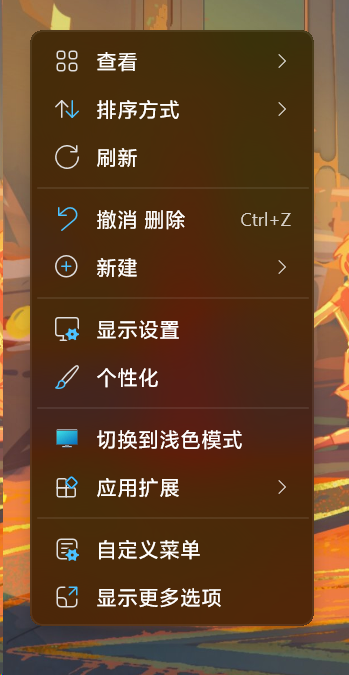

<p align="center"></p>

# Windows Theme Switcher · 深浅色切换器

通过桌面右键菜单，快速切换 Windows 深色与浅色模式。

**[下载最新版](https://github.com/hakanasora/windows-theme-switcher/releases/latest)** · [查看更新](CHANGELOG.md)

## 为什么开发

不同的使用环境下，用户对颜色模式的偏好也会有所变化。有些用户习惯白天使用浅色模式，夜间使用深色模式，并希望根据需要随时切换。

Windows 的颜色模式选项位于「设置」中。对于经常调整颜色模式的用户，每次打开设置并进入相应页面，略显繁琐。

Windows Theme Switcher 将这项操作放入桌面右键菜单：**在桌面空白处点击右键，选择切换项即可完成切换。** 切换效果与 Windows「设置」中的颜色模式选项一致。

## 功能

- **右键即可切换**：无需进入系统设置，也无需打开独立程序窗口。
- **当前操作一目了然**：浅色模式下显示「切换到深色模式」及深色图标；深色模式下则显示「切换到浅色模式」及浅色图标。
- **适配两种菜单**：支持 Windows 11 新式菜单，也可在传统菜单中使用。
- **使用过程简洁**：没有主窗口、托盘图标或开机启动项。
- **支持命令行调用**：可通过 `light`、`dark` 或 `toggle` 参数，在快捷方式或脚本中调用。

## 效果展示



## 安装与使用

1. 从 [Releases](https://github.com/hakanasora/windows-theme-switcher/releases/latest) 下载 `ThemeSwitcherSetup.exe`。
2. 双击安装包，允许 Windows 的管理员权限提示，按提示完成安装。
3. 在桌面空白处点击右键，选择「切换到深色模式」或「切换到浅色模式」。

适用于原生 x64 的 Windows 10 和 Windows 11。安装不需要额外导入证书，也无需安装 .NET 或 Visual C++ 运行库。

在支持菜单个性化设置的 Windows 11 上，首次安装会初始化一级菜单显示。你仍可在「个性化 → 上下文菜单」中调整；后续升级会保留已有选择。其他版本的显示位置由系统决定，入口也可能位于「应用扩展」或「显示更多选项」中。

部分应用可能需要重新打开，才能应用新的颜色模式。

## 升级与卸载

已有版本可直接运行新版安装包覆盖安装，无需先手动卸载。

需要移除时，在 Windows「已安装的应用」中卸载即可。卸载会移除程序及其添加的菜单入口，并清理空的安装目录；卸载不会改变当前颜色模式。若你在安装目录中另外存放了文件，这些文件会保留。

## 命令行使用

在程序安装目录中运行：

```powershell
.\ThemeSwitcher.exe light    # 切换到浅色模式
.\ThemeSwitcher.exe dark     # 切换到深色模式
.\ThemeSwitcher.exe toggle   # 切换到另一种模式
```

## 开发与源码

构建方法、工作原理和项目结构见 [开发说明](DEVELOPMENT.md)，验证范围见 [测试记录](docs/TESTING.md)。

1.0 的恢复源码及过程说明保留在 [RECOVERY.md](RECOVERY.md)；2.0 使用 Windows 原生 C++ 实现。

## 许可证

本项目代码采用 [MIT 许可证](LICENSE)。Windows 系统图标不包含在该代码许可范围内。
