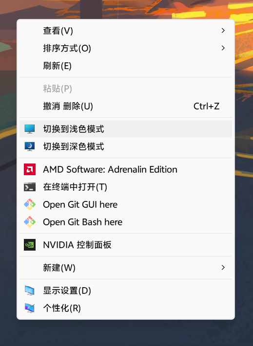

<p align="center"></p>

# Windows Theme Switcher · 深浅色切换器

通过桌面右键菜单，快速切换 Windows 深色与浅色模式。

**[下载最新版](https://github.com/hakanasora/windows-theme-switcher/releases/latest)**

## 为什么开发

不同的使用环境下，用户对颜色模式的偏好也会有所变化。有些用户习惯白天使用浅色模式，夜间使用深色模式，并希望根据需要随时切换。

Windows 11 的颜色模式选项位于「设置」中，切换时需要打开设置并进入相应页面。对于经常调整颜色模式的用户，这一操作略显繁琐。

Windows Theme Switcher 将这项操作放入桌面右键菜单。**在桌面空白处点击右键，选择浅色或深色模式即可完成切换。** 切换效果与 Windows「设置」中的颜色模式选项一致。

## 功能

- **桌面右键切换**：直接选择浅色或深色模式，无需进入系统设置。
- **使用简洁**：选择模式后即可切换，不显示额外窗口，也不会在后台持续运行。
- **命令行支持**：可通过快捷方式或脚本指定颜色模式。

## 效果展示



## 安装与使用

安装包面向 Windows 10 及以上的 x64 系统，安装时需要管理员权限。

1. 从[最新版下载页面](https://github.com/hakanasora/windows-theme-switcher/releases/latest)下载 `ThemeSwitcherSetup.exe`。
2. 运行安装程序，完成安装。
3. 在桌面空白处点击右键，选择「切换到浅色模式」或「切换到深色模式」。

如果 Windows 11 的右键菜单没有直接显示这两个选项，可以先点击「显示更多选项」。

部分应用可能需要重新打开，才能应用新的颜色模式。

### 卸载与清理

如需移除工具，可在 Windows 的已安装应用列表中卸载。**卸载会同时移除程序文件及其添加的右键菜单项**，无需手动删除文件或清理菜单。

卸载不会改变当前的颜色模式。

### 命令行调用

在 `ThemeSwitcher.exe` 所在目录中运行：

```powershell
# 浅色模式
.\ThemeSwitcher.exe light

# 深色模式
.\ThemeSwitcher.exe dark
```

模式参数不区分大小写。不带参数或传入不支持的模式时，程序直接退出。

## 从源码构建

### 编译程序

需要 Windows 和 .NET Framework 4 系列 C# 编译器。构建脚本会在 Windows 的 .NET Framework 目录中查找 `csc.exe`，不需要下载 NuGet 依赖。

在项目根目录运行：

```powershell
powershell -NoProfile -ExecutionPolicy Bypass -File .\build.ps1
```

编译结果为项目根目录下的 `ThemeSwitcher.exe`。

项目也提供 `src/ThemeSwitcher.csproj`，可在安装了对应 .NET Framework 开发工具的环境中使用。

### 生成安装包

安装 Inno Setup 后，在项目根目录运行：

```powershell
powershell -NoProfile -ExecutionPolicy Bypass -File .\build.ps1 -Installer
```

如果无法自动找到 Inno Setup，可手动指定编译器路径：

```powershell
powershell -NoProfile -ExecutionPolicy Bypass -File .\build.ps1 -Installer -IsccPath "C:\Program Files (x86)\Inno Setup 6\ISCC.exe"
```

安装包输出至 `dist/ThemeSwitcherSetup.exe`。

## 工作原理

程序修改当前用户注册表中的两项 DWORD 设置：

```text
HKEY_CURRENT_USER\SOFTWARE\Microsoft\Windows\CurrentVersion\Themes\Personalize
```

| 设置项 | 作用 | 浅色模式 | 深色模式 |
| --- | --- | --- | --- |
| `AppsUseLightTheme` | 支持主题跟随的应用 | `1` | `0` |
| `SystemUsesLightTheme` | Windows 系统颜色模式 | `1` | `0` |

写入后，通过 `SendMessageTimeout` 广播 `WM_SETTINGCHANGE`，通知系统和应用刷新主题。

程序沿用原有的静默执行方式：设置路径不存在时不会创建，操作异常时不会弹窗提示。

## 项目结构

```text
.
├── assets/                     # 应用图标与首页展示图标
├── src/
│   ├── ThemeSwitcher.cs         # 主题切换逻辑
│   └── ThemeSwitcher.csproj     # C# 项目文件
├── docs/                       # 截图和验证记录
├── InstallerScript.iss         # Inno Setup 安装脚本
├── MyIcon.ico                  # 程序与安装包图标
├── build.ps1                   # 编译与打包脚本
├── LICENSE                     # MIT 代码许可证
├── RECOVERY.md                 # 源码恢复记录
└── README.md
```

## 源码说明

原始 C# 源文件遗失后，本项目根据作者保留的 `ThemeSwitcher.exe` 恢复源码，并补齐项目文件和构建说明。恢复版已通过编译验证，所有方法的 IL 指令与原程序一致。

恢复过程与验证范围见 [RECOVERY.md](RECOVERY.md)。

首次发布的主程序和安装包直接采用作者保留的原始编译文件。源码构建说明供审阅、学习和后续维护使用。

## 许可证

本项目代码采用 [MIT 许可证](LICENSE)。Windows 系统图标不包含在该代码许可范围内。
